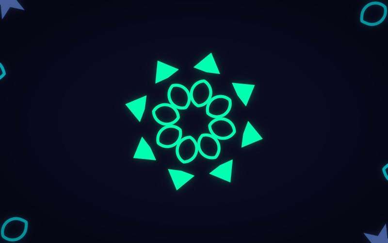
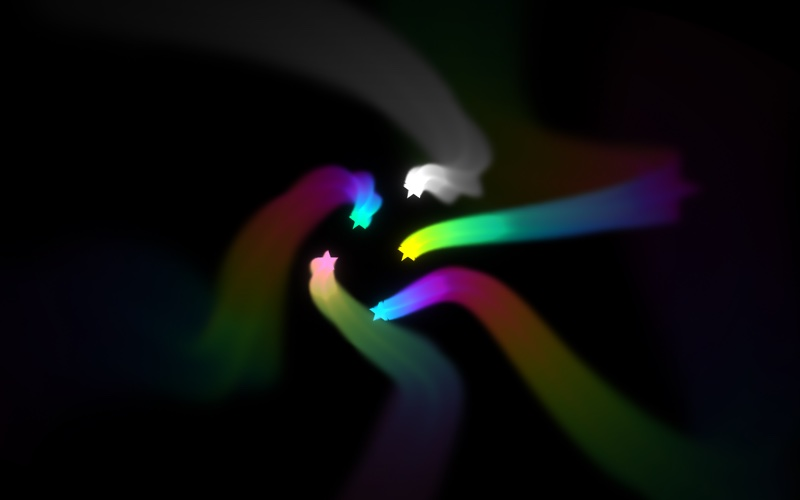
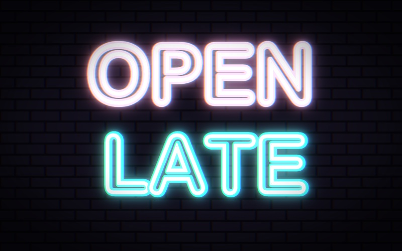
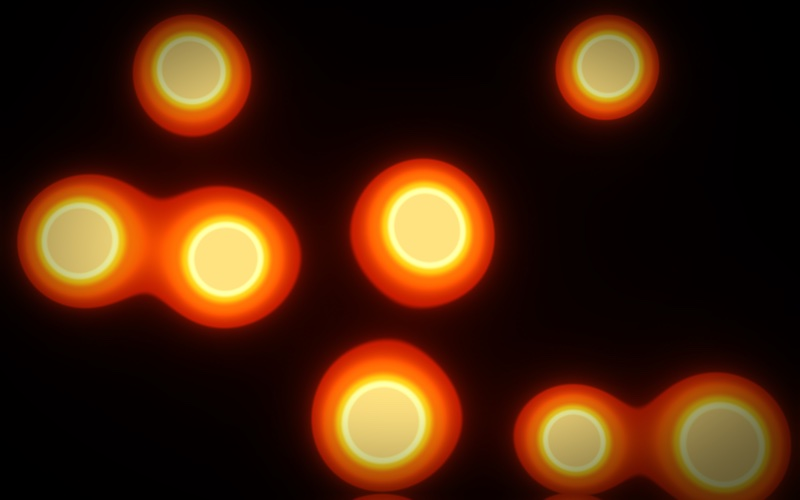
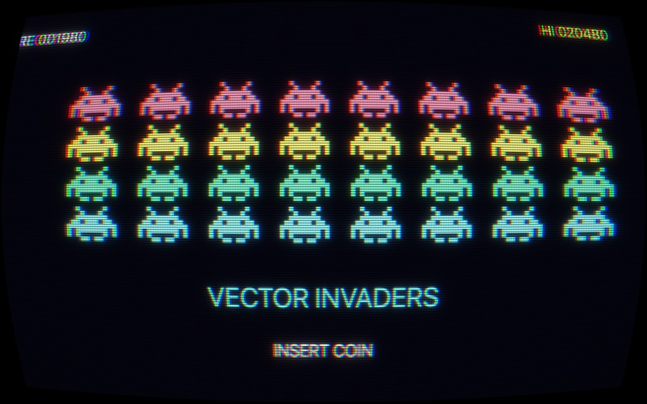
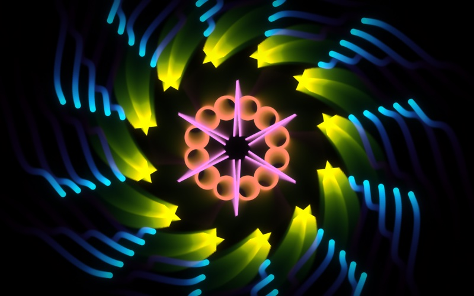
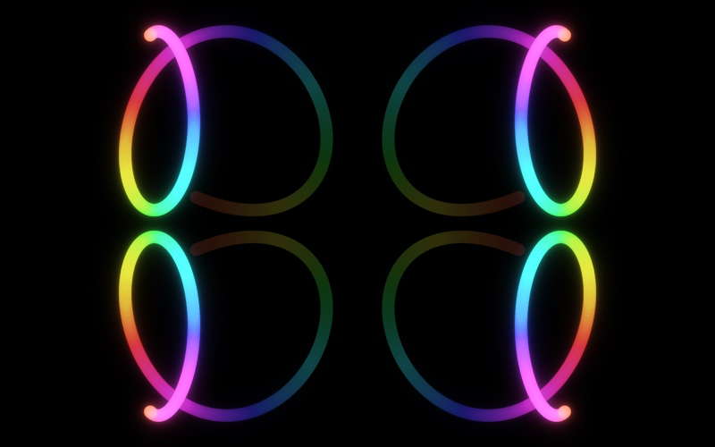
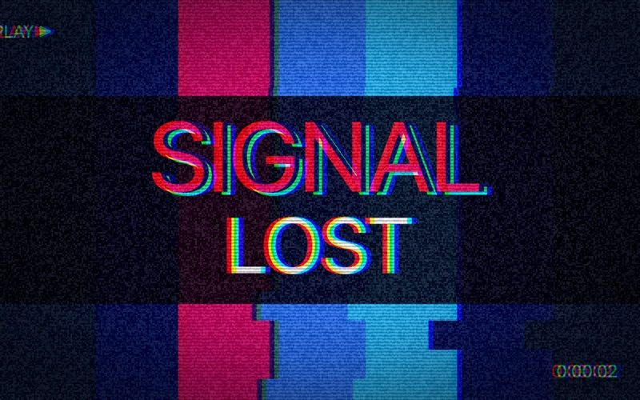

# vfx.js

Effects for a scene. Draw some shapes, then turn one on: a kaleidoscope, a glow, trails that spin away into a tunnel, an old television, a glitch. The graphics card does the work, so they are fast, and each is one line.



It is a sibling of [pictures.js](https://www.circuitry.dev/pictures), [synths.js](../synths.js) and [dials.js](../dials.js), and works with any page that has a canvas. The Python version is [vfx-py](../vfx-py), for Pyctures. (`vfx` is a working name.)

```js
function draw() {
  background("black")
  circle(mouse.x, mouse.y, 40, "gold")
}

glow(1)                 // bright things shine
trails(1.5)             // and leave a trail that takes a second and a half to fade
```

That is a whole scene. There is nothing to load and nothing to call in `draw()`: an effect that is on is applied to every frame, after your drawing.

## Start here

### 1. Turn one on

```js
kaleidoscope(8)         // eight segments
```

Every effect is a function. Calling it turns it on. The first number is the thing you most often want to change, and it has a sensible value if you leave it out.

A kaleidoscope shows one slice of your picture, the one that starts at the middle and points right, folded round and round. If the screen goes dark, nothing was drawn in that slice: fill the picture, or turn the slice with `angle`.

### 2. Change its settings

```js
const pattern = kaleidoscope(8, { zoom: 1.5 })

function update(dt) {
  pattern.angle += 20 * dt        // turn it, twenty degrees a second
  pattern.x = mouse.x             // its middle follows the mouse
  pattern.y = mouse.y
}
```

An effect's settings are plain properties: read them, set them, add to them, every frame if you like. Give one a function and it is asked every frame:

```js
pattern.segments = () => 4 + 2 * Math.floor(time)
```

Lengths are in the same points as the rest of your scene and angles are in degrees, so a scene looks the same on a phone and on a big screen.

### 3. Use several

```js
kaleidoscope(6)
trails(0.7, { zoom: 1.5, spin: 25, hue: 90 })
glow(0.7)
vignette()
```

Effects are applied **in the order you turn them on**. Here the picture is folded, then the folded picture leaves trails, then all of it glows. Swap two lines and you get a different picture.

Each effect has `off()`, `on()` and `remove()`, and `amount` from 0 to 1 for how much of it is mixed in. `clearEffects()` takes them all away.

### 4. Or take a ready-made look

```js
look("arcade")          // the curved glass of an old arcade machine
```

A look is several effects at once: `dream`, `arcade`, `vhs`, `neon`, `comic`, `underwater`, `oldfilm`, `disco`, `terminal`. It gives its parts back by name, so `look("vhs").glitch.strength = 1` works.

### 5. A picture with no drawing at all

```js
metaballs("lava")       // blobs that melt into each other
glow(0.6)
function draw() { background() }     // with no colour: wipe the picture clear
```

`plasma`, `starfield`, `metaballs` and `flow` are **backdrops**: pictures the graphics card makes by itself. They are behind whatever you draw, and show wherever you have left the canvas clear. So do not paint a background colour over them: `background()` with no colour wipes the canvas clear each frame.

## Every effect


| | What it does | The settings (the first is the one a plain number sets) |
|---|---|---|
| `kaleidoscope(8)` | One slice of the picture, folded round | `segments`, `angle`, `zoom`, `x`, `y` |
| `mirror("left")` | One half shown on both sides | `side`: `"left"`, `"right"`, `"top"`, `"bottom"`, `"four"` |
| `tile(3)` | The picture repeated | `across`, `down`, `flip` |
| `pixelate(10)` | Big square pixels | `size` |
| `waves(12)` | A flag in the wind | `size`, `length`, `speed` |
| `ripple(8)` | Rings spreading from a point | `size`, `length`, `speed`, `x`, `y` |
| `wobble(14)` | Heat haze, or water | `size`, `scale`, `speed` |
| `swirl(180)` | The middle twisted round | `angle`, `radius`, `x`, `y` |
| `fisheye(0.5)` | A bulge (below 0: a pinch). Also `bulge` | `strength`, `radius`, `x`, `y` |
| `tunnel(0.4)` | The picture as the walls of a tunnel | `speed`, `repeat`, `depth`, `x`, `y` |
| `blur(8)` | Out of focus | `radius` |
| `zoomBlur(0.25)` | Rushing towards a point | `strength`, `x`, `y` |
| `spinBlur(8)` | Spinning round a point | `angle`, `x`, `y` |
| `glow(0.8)` | Bright things shine. Also `bloom` | `strength`, `threshold`, `radius` |
| `trails(0.5)` | What was drawn stays, and fades | `length` (seconds to fade to a tenth), `zoom`, `spin`, `hue`, `dx`, `dy`, `x`, `y` |
| `rgbSplit(4)` | Red and blue pulled apart | `size`, `angle`, `spread` |
| `hue(90)` | Every colour moved round the wheel | `shift`, `speed` (degrees a second) |
| `saturate(1.6)` | More colour (0: grey) | `strength` |
| `brighten(1.3)`, `contrast(1.4)` | | `strength` |
| `invert()` | A negative | |
| `posterize(4)` | Only a few shades | `levels` |
| `tint("gold")` | Seen through coloured glass | `colour` |
| `duotone("midnightblue", "gold")` | Two colours: one for dark, one for light | `dark`, `light` |
| `colourCycle("rainbow")` | Brightness becomes colour, and the colours move. Also `colorCycle` | `palette`, `speed`, `bands` |
| `scanlines(0.5)` | Dark lines across | `strength`, `size` |
| `crt(0.18)` | An old television: curved glass, lines, coloured stripes | `curve`, `lines`, `size` |
| `glitch(0.5)` | Blocks that jump, a line that tears, snow | `strength`, `speed`, `seed` |
| `grain(0.18)` | Film grain | `strength`, `size`, `seed` |
| `vignette(0.6)` | Dark corners | `strength`, `size`, `colour` |
| `edges(2)` | Only the outlines, in their own colours | `strength`, `size`, `fill` |
| `dots(9)` | Printed in dots, as a comic is. Also `halftone` | `size`, `angle`, `paper` |
| `letters(10)` | Made of marks, as an old terminal would show it | `size`, `colour`, `own` |
| `plasma("sunset")` | Backdrop: slow rolling colour | `palette`, `speed`, `scale` |
| `starfield(0.5)` | Backdrop: flying through stars | `speed`, `stars`, `colour`, `x`, `y` |
| `metaballs("neon")` | Backdrop: blobs that melt together | `palette`, `speed`, `count`, `size` |
| `flow("ocean")` | Backdrop: ink in water | `palette`, `speed`, `scale` |

Every effect also has `amount`. A palette is a name (`rainbow`, `fire`, `ocean`, `sunset`, `neon`, `candy`, `forest`, `ice`, `lava`, `mono`) or your own list of colours: `plasma(["navy", "magenta", "gold"])`. A colour is anything the page understands: `"gold"`, `"#ff8800"`.

**Trails** are how the classic screensaver tunnel is made: each frame is last frame's picture, a little bigger (`zoom`: 2 doubles its size every second), a little turned (`spin`, degrees a second) and a little changed in colour (`hue`), with this frame's drawing on top. They are measured in seconds, not frames, so a scene looks the same at 30 and at 120 frames a second. Trails want a dark background: only what is brighter than the trail is seen over it.

A mistake is said in plain words, with what to do instead:

```
kaleidoscope has no setting called "segmnts". Its settings are segments, angle, zoom, x, y, amount
```

## Music

With [synths.js](../synths.js) in the scene (in pictures.js it is: `playNotes`, `makeSynth`), the effects can move to the music.

```js
playNotes("C2 - C2 C2 - C2 G1 -", 0.25, { repeat: true })

const shine = glow(0.5)
react(shine, "strength", "bass", { from: 0.4, to: 1.5 })     // the glow follows the bass
```

Five numbers follow the sound, each from 0 to 1 and smoothed so they look musical:

| | |
|---|---|
| `bass()` | the low notes: a kick drum, a bass line |
| `mids()` | the middle: chords, a voice |
| `highs()` | the top: hi-hats, sparkle |
| `loudness()` | all of it |
| `pulse()` | jumps to 1 on each beat and falls away |

Use them anywhere: `circle(x, y, 20 + 60 * bass(), "tomato")`, or `shine.strength = () => 0.3 + bass()`. `react(effect, "setting", "bass", { from, to })` is the same thing in one line.

In a pictures.js scene the effects listen to all the sound by themselves. To listen to one thing, or on a page of your own, say what: `listenTo(lead)`, `listenTo(song)`, `listenTo(useMicrophone())`, or anything that has `samples()` (its latest sound as numbers from -1 to 1). With nothing to listen to, the five numbers are 0 and nothing goes wrong. Quiet music moves them as much as loud: they are measured against how loud it has been lately.

For motion that is exactly on the beat, the sound library's own clock is better than listening: `pattern.angle = () => beat() * 45`.

## Dials

An effect is something [dials.js](../dials.js) can turn:

```js
const soft = blur(4)
dial("blur", soft, "radius")        // the dial takes its range from the effect
```

The dials are drawn over the effects, so they are never blurred or folded.

## A shader of your own

If you know the language graphics cards speak (GLSL), an effect is one function: the colour at one place of the picture.

```js
const wave = shader(`
  vec4 effect(vec2 uv) {
    uv.x += 0.02 * sin(uv.y * 40.0 + time * speed);
    return texture(picture, uv);
  }`, { speed: 3 })

wave.speed = 6
```

`uv` runs from (0, 0) at the top left to (1, 1) at the bottom right. The settings you give are numbers the program can use by name (`speed: 3`, or `speed: [3, 0, 10]` with a range for a dial; a colour, `"gold"`, is a `vec3`). It is also given:

| | |
|---|---|
| `picture` | what this effect is given: `texture(picture, uv)` |
| `previous` | what this effect made last frame, for feedback: `texture(previous, uv)` |
| `resolution`, `size` | the picture's size in real pixels, and in the scene's points |
| `time`, `dt`, `frame` | seconds on the scene's clock, seconds since the last frame, frames so far |
| `amount` | this effect's amount |
| `bass`, `mids`, `highs`, `loudness`, `pulse` | the music, 0 to 1 |
| `spectrum`, `waveform` | the sound as pictures: `texture(spectrum, vec2(x, 0.5)).r` is how much there is of each pitch, low at the left; `waveform` is the wave itself, with 0.5 for silence |
| `hash(p)`, `noise(p)`, `fbm(p)`, `luma(c)`, `turn(p, a)`, `hueTurn(c, a)`, `mirrored(uv)`, `TAU` | small helpers: the same random numbers on every graphics card, smooth noise, brightness, turning a point and a colour |

A mistake is said with its line and the card's own words:

```
Your shader has a mistake the graphics card will not accept:
line 3: 'sped' : undeclared identifier
```

## Recording a video

Every effect is worked out from the picture, its own last frame, its settings and the scene's clock, never from the time of day; grain and glitches come from a seed. So a scene stepped one frame at a time gives exactly the pictures it should, and the tests check it: the same scene stepped twice gives the very same pixels, and a film at 30 frames a second matches one at 60 at the same moments.

**In Circuitry**, the video button under the preview records the effects with no more to do (see [docs/circuitry.md](docs/circuitry.md)).

**Anywhere else**, the library can do it:

```js
const film = await recordVideo({ seconds: 5, fps: 60 })     // a WebM, every frame exactly 1/60 apart
saveVideo(film, "my-scene.webm")
```

`recordVideo` needs a browser that can encode video (Chrome, Edge, Safari). `renderFrames({ seconds, fps, onFrame })` gives the frames one at a time instead, each on a canvas, for you to do as you like with. Neither has sound in it.

## How fast it is

The scene's canvas is handed to the graphics card once a frame; each effect is then one or a few passes over the picture. What that costs on an M-series Mac, at an iPad's size (1180 × 820 points), in milliseconds a frame (`node scripts/measure.mjs`):

| | Chromium 1× | Chromium 2× | WebKit 1× | WebKit 2× |
|---|---|---|---|---|
| The hand-over and one effect | 0.4 | 0.2 | 2.6 | 10.0 |
| `blur(8)` | 0.3 | 0.8 | 2.9 | 10.3 |
| `glow()` | 0.5 | 1.0 | 2.9 | 10.4 |
| kaleidoscope, trails, glow, vignette | 0.5 | 1.8 | 3.1 | 11.6 |
| `look("vhs")`, six effects | 0.4 | 1.6 | 3.1 | 11.1 |

The effects themselves are cheap everywhere. **The hand-over is not, in Safari's engine**: it reads every pixel of the canvas back before the graphics card gets it, about 2.6 milliseconds for each million pixels on this Mac, and every browser on an iPad uses that engine. So:

- `effectsQuality("auto")`, the default, starts a touch device at about a 1080p picture's worth of pixels, and whenever the hand-over takes more than 4 ms it works on fewer (never fewer than one for each of the scene's points). The picture is made smaller before it is handed over, which is what saves the time, and is stretched back on the screen. With that, WebKit 2× above costs about 5 ms.
- `effectsQuality(1)` is every pixel, `effectsQuality(0.5)` half each way.
- Under a recorder's stepped clock nothing is ever late, so a recording keeps every pixel.

A scene with no effect on has no second canvas and no graphics-card context: it costs what it did before. Blur and glow do their wide work on small copies of the picture; glow is judged pixel by pixel so small bright things do not flicker; a blurred slope has a grain too fine to see, so it has no bands; trails are kept in finer shades than the screen has, so they fade to black and not to mud.

When a scene stops, everything it had on the graphics card is given back; the context and the compiled programs are kept for the next run, so running again is quick. If the graphics card takes the context away (a tablet does, to a tab in the background), the effects are made again when it comes back.

## On a page of your own

```html
<canvas id="c" width="800" height="500"></canvas>
<script type="module">
  import { effects } from "./vfx.js"
  const c = document.getElementById("c"), g = c.getContext("2d")
  const { glow, trails } = effects(c)
  glow(1); trails(1)
  requestAnimationFrame(function tick(t) {
    requestAnimationFrame(tick)
    g.fillStyle = "black"; g.fillRect(0, 0, 800, 500)
    g.fillStyle = "gold"; g.fillRect(400 + 300 * Math.sin(t / 500), 230, 40, 40)
  })
</script>
```

The result is shown on a canvas of its own, laid exactly over yours, and each frame is run after your drawing. A host that knows when the scene has drawn says so itself: `const fx = effects(canvas, { manual: true })`, then `fx.frame(dt)` after each draw. It also has `fx.pixels()`, `fx.onFrame(fn)`, `fx.stats()` and `fx.close()`. A 3D canvas (three.js, or WebGL of your own) works the same way.

## The demos

Each is a folder in [`demos/`](demos) with its code, a note and a picture taken from the demo itself; five have a Python twin.

| | |
|---|---|
| [kaleidoscope](demos/kaleidoscope)  | [tunnel](demos/tunnel)  |
| [neon-sign](demos/neon-sign)  | [lava-lamp](demos/lava-lamp)  |
| [arcade](demos/arcade)  | [visualiser](demos/visualiser)  |
| [finger-paint](demos/finger-paint)  | [glitch-title](demos/glitch-title)  |

## Working on it

```
PLAYWRIGHT=/path/to/node_modules/playwright node scripts/test-vfx.mjs     # the tests, in Chromium and WebKit
PLAYWRIGHT=… node scripts/shots.mjs                                       # the demos' pictures
PLAYWRIGHT=… node scripts/gallery.mjs                                     # the picture of every effect
PLAYWRIGHT=… node scripts/measure.mjs                                     # what chains cost on this computer
node scripts/serve.mjs                                                    # a server to try scenes on: /demo.html?d=demos/tunnel/main.js
```

The tests measure the pixels: a kaleidoscope's symmetry, what a blur takes away, where a hue lands, how fast a trail fades, that order matters and `off()` gives the scene's own canvas back exactly, that nothing is left on the graphics card after forty runs, that a lost context comes back, and that the music's numbers follow a made-up tone and a drum. No sound is made.

pictures.js, Pyctures and Circuitry each need a small change to give a scene these functions with nothing to load: [docs/pictures.js.md](docs/pictures.js.md), [docs/pyctures.md](docs/pyctures.md), [docs/circuitry.md](docs/circuitry.md). Until then a pictures.js scene begins with `const { glow, trails } = await use("vfx.js")`.

MIT licence. The shaders are written for this library.
