# Every effect

<!-- Written by scripts/docs.mjs from the table in visualfx.js. Do not edit it by hand: change the table and run the script. -->

There are 94 effects and 16 looks. Each effect is one line to turn on; the value in the brackets is the one a plain number (or name) sets, and every other setting goes in by name: `glow(0.8, { radius: 40 })`, or in Python `glow(0.8, radius=40)`. A setting can be changed at any time: `shine.radius = 60`.

Every effect also has `amount`, from 0 to 1: how much of it is mixed in. Lengths are in the scene's points and angles in degrees. A place (`x`, `y`) is the middle of the picture unless you say.

The palettes: `rainbow`, `fire`, `ocean`, `sunset`, `neon`, `candy`, `forest`, `ice`, `lava`, `mono`, `thermal`, `aurora`, `gameboy`, `c64`, `amiga`, `pico`, or your own list of colours.

## Contents

- **Shapes of the picture**: [kaleidoscope](#kaleidoscope), [mirror](#mirror), [pixelate](#pixelate), [waves](#waves), [ripple](#ripple), [wobble](#wobble), [swirl](#swirl), [fisheye](#fisheye), [tunnel](#tunnel), [tile](#tile), [droste](#droste), [rotozoom](#rotozoom), [hexagons](#hexagons), [glassTiles](#glasstiles), [frosted](#frosted), [heatHaze](#heathaze), [caustics](#caustics), [shake](#shake), [punch](#punch)
- **Blur and light**: [zoomBlur](#zoomblur), [spinBlur](#spinblur), [motionBlur](#motionblur), [tiltShift](#tiltshift), [lightRays](#lightrays), [streaks](#streaks), [softFocus](#softfocus), [blur](#blur), [glow](#glow)
- **What was drawn stays**: [smear](#smear), [stutter](#stutter), [trails](#trails)
- **Colours**: [rgbSplit](#rgbsplit), [hue](#hue), [saturate](#saturate), [brighten](#brighten), [contrast](#contrast), [invert](#invert), [posterize](#posterize), [tint](#tint), [duotone](#duotone), [colourCycle](#colourcycle), [gradientMap](#gradientmap), [thermal](#thermal), [nightVision](#nightvision), [sepia](#sepia), [threshold](#threshold), [solarize](#solarize), [colourBleed](#colourbleed), [rainbowEdges](#rainbowedges)
- **Screens and old computers**: [scanlines](#scanlines), [crt](#crt), [glitch](#glitch), [letters](#letters), [dither](#dither), [interlace](#interlace), [led](#led)
- **Drawn, printed and painted**: [edges](#edges), [dots](#dots), [emboss](#emboss), [sharpen](#sharpen), [sketch](#sketch), [cartoon](#cartoon), [stainedGlass](#stainedglass), [crosshatch](#crosshatch), [oil](#oil)
- **In front of the picture**: [grain](#grain), [vignette](#vignette), [dust](#dust), [lightLeaks](#lightleaks), [rain](#rain), [snow](#snow), [bokeh](#bokeh), [fog](#fog), [lightning](#lightning)
- **Backdrops that need no drawing**: [plasma](#plasma), [starfield](#starfield), [metaballs](#metaballs), [flow](#flow), [warp](#warp), [voronoi](#voronoi), [moire](#moire), [interference](#interference), [aurora](#aurora), [fire](#fire), [clouds](#clouds), [matrixRain](#matrixrain), [copperBars](#copperbars), [checkerFloor](#checkerfloor), [twister](#twister)
- **The music, drawn**: [spectrumBars](#spectrumbars), [spectrumRing](#spectrumring), [waveformRing](#waveformring), [beatFlash](#beatflash), [bassShake](#bassshake)
- **Looks**: [dream](#look-dream), [arcade](#look-arcade), [vhs](#look-vhs), [neon](#look-neon), [comic](#look-comic), [underwater](#look-underwater), [oldfilm](#look-oldfilm), [disco](#look-disco), [gameboy](#look-gameboy), [c64](#look-c64), [noir](#look-noir), [comicbook](#look-comicbook), [storm](#look-storm), [winter](#look-winter), [cinema](#look-cinema), [terminal](#look-terminal)

## Shapes of the picture

### kaleidoscope

One slice of the picture, folded round and round. The slice starts at the middle and points right: turn it with angle.

| JavaScript | Python |
|---|---|
| `kaleidoscope(8)` | `kaleidoscope(8)` |

| Setting | In Python | Starts at | Can be |
|---|---|---|---|
| `segments` | `segments` | `8` | 2 to 32, a whole number |
| `angle` | `angle` | `0` | -360 to 360 degrees |
| `zoom` | `zoom` | `1` | 0.2 to 5 |
| `x` | `x` | the middle | a place in the scene |
| `y` | `y` | the middle | a place in the scene |
| `amount` | `amount` | `1` | 0 to 1 |

### mirror

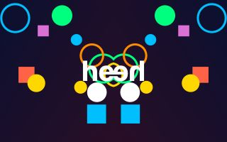

One half of the picture shown on both sides, or one quarter in all four.

| JavaScript | Python |
|---|---|
| `mirror("left")` | `mirror("left")` |

| Setting | In Python | Starts at | Can be |
|---|---|---|---|
| `side` | `side` | `"left"` | `"left"`, `"right"`, `"top"`, `"bottom"`, `"four"` |
| `amount` | `amount` | `1` | 0 to 1 |

### pixelate

Big square pixels.

| JavaScript | Python |
|---|---|
| `pixelate(10)` | `pixelate(10)` |

| Setting | In Python | Starts at | Can be |
|---|---|---|---|
| `size` | `size` | `10` | 1 to 100 |
| `amount` | `amount` | `1` | 0 to 1 |

### waves

The picture ripples like a flag in the wind.

| JavaScript | Python |
|---|---|
| `waves(12)` | `waves(12)` |

| Setting | In Python | Starts at | Can be |
|---|---|---|---|
| `size` | `size` | `12` | 0 to 100 |
| `length` | `length` | `160` | 10 to 1000 |
| `speed` | `speed` | `0.5` | -5 to 5 |
| `amount` | `amount` | `1` | 0 to 1 |

### ripple

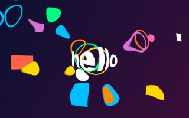

Rings spreading from a point, as from a stone dropped in water.

| JavaScript | Python |
|---|---|
| `ripple(8)` | `ripple(8)` |

| Setting | In Python | Starts at | Can be |
|---|---|---|---|
| `size` | `size` | `8` | 0 to 100 |
| `length` | `length` | `60` | 10 to 1000 |
| `speed` | `speed` | `1` | -5 to 5 |
| `x` | `x` | the middle | a place in the scene |
| `y` | `y` | the middle | a place in the scene |
| `amount` | `amount` | `1` | 0 to 1 |

### wobble

The picture wobbles like jelly, or something seen under water.

| JavaScript | Python |
|---|---|
| `wobble(14)` | `wobble(14)` |

| Setting | In Python | Starts at | Can be |
|---|---|---|---|
| `size` | `size` | `14` | 0 to 100 |
| `scale` | `scale` | `120` | 10 to 1000 |
| `speed` | `speed` | `0.4` | -5 to 5 |
| `amount` | `amount` | `1` | 0 to 1 |

### swirl

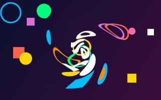

The middle of the picture twisted round, like stirred paint.

| JavaScript | Python |
|---|---|
| `swirl(180)` | `swirl(180)` |

| Setting | In Python | Starts at | Can be |
|---|---|---|---|
| `angle` | `angle` | `180` | -1440 to 1440 degrees |
| `radius` | `radius` | `0` | 0 to 2000 |
| `x` | `x` | the middle | a place in the scene |
| `y` | `y` | the middle | a place in the scene |
| `amount` | `amount` | `1` | 0 to 1 |

### fisheye

A bulge, as through a round lens. Below zero it pinches instead.

| JavaScript | Python |
|---|---|
| `fisheye(0.5)` | `fisheye(0.5)` |

Also called `bulge`.

| Setting | In Python | Starts at | Can be |
|---|---|---|---|
| `strength` | `strength` | `0.5` | -1 to 1 |
| `radius` | `radius` | `0` | 0 to 2000 |
| `x` | `x` | the middle | a place in the scene |
| `y` | `y` | the middle | a place in the scene |
| `amount` | `amount` | `1` | 0 to 1 |

### tunnel

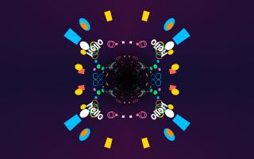

The picture becomes the walls of a tunnel you are flying down.

| JavaScript | Python |
|---|---|
| `tunnel(0.4)` | `tunnel(0.4)` |

| Setting | In Python | Starts at | Can be |
|---|---|---|---|
| `speed` | `speed` | `0.4` | -5 to 5 |
| `repeat` | `repeat` | `2` | 1 to 12, a whole number |
| `depth` | `depth` | `0.5` | 0.05 to 4 |
| `x` | `x` | the middle | a place in the scene |
| `y` | `y` | the middle | a place in the scene |
| `amount` | `amount` | `1` | 0 to 1 |

### tile

The picture repeated in rows and columns.

| JavaScript | Python |
|---|---|
| `tile(3)` | `tile(3)` |

| Setting | In Python | Starts at | Can be |
|---|---|---|---|
| `across` | `across` | `3` | 1 to 40, a whole number |
| `down` | `down` | `0` | 0 to 40, a whole number |
| `flip` | `flip` | `false` | true or false |
| `amount` | `amount` | `1` | 0 to 1 |

### droste

The picture inside itself, smaller each time, for ever. With a twist it winds in as a spiral.

| JavaScript | Python |
|---|---|
| `droste(3)` | `droste(3)` |

| Setting | In Python | Starts at | Can be |
|---|---|---|---|
| `zoom` | `zoom` | `3` | 1.2 to 10 |
| `twist` | `twist` | `1` | 0 to 4, a whole number |
| `speed` | `speed` | `0.3` | -5 to 5 |
| `x` | `x` | the middle | a place in the scene |
| `y` | `y` | the middle | a place in the scene |
| `amount` | `amount` | `1` | 0 to 1 |

### rotozoom

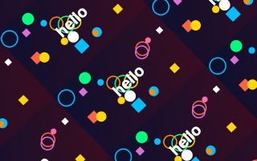

The picture tiled, turning and zooming: an old demo-scene favourite.

| JavaScript | Python |
|---|---|
| `rotozoom(0.5)` | `rotozoom(0.5)` |

| Setting | In Python | Starts at | Can be |
|---|---|---|---|
| `speed` | `speed` | `0.5` | -5 to 5 |
| `zoom` | `zoom` | `1.5` | 0.2 to 8 |
| `amount` | `amount` | `1` | 0 to 1 |

### hexagons

Six-sided pixels, like a honeycomb.

| JavaScript | Python |
|---|---|
| `hexagons(14)` | `hexagons(14)` |

| Setting | In Python | Starts at | Can be |
|---|---|---|---|
| `size` | `size` | `14` | 3 to 100 |
| `amount` | `amount` | `1` | 0 to 1 |

### glassTiles

Seen through a wall of glass blocks.

| JavaScript | Python |
|---|---|
| `glassTiles(40)` | `glass_tiles(40)` |

| Setting | In Python | Starts at | Can be |
|---|---|---|---|
| `size` | `size` | `40` | 6 to 300 |
| `strength` | `strength` | `0.4` | 0 to 1 |
| `amount` | `amount` | `1` | 0 to 1 |

### frosted

Seen through frosted glass.

| JavaScript | Python |
|---|---|
| `frosted(6)` | `frosted(6)` |

| Setting | In Python | Starts at | Can be |
|---|---|---|---|
| `size` | `size` | `6` | 0 to 60 |
| `amount` | `amount` | `1` | 0 to 1 |

### heatHaze

The shimmer of hot air rising.

| JavaScript | Python |
|---|---|
| `heatHaze(5)` | `heat_haze(5)` |

| Setting | In Python | Starts at | Can be |
|---|---|---|---|
| `size` | `size` | `5` | 0 to 60 |
| `scale` | `scale` | `40` | 5 to 400 |
| `speed` | `speed` | `1` | -5 to 5 |
| `amount` | `amount` | `1` | 0 to 1 |

### caustics

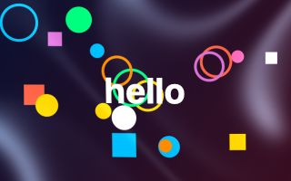

The net of bright lines that sunlight makes on the floor of a pool.

| JavaScript | Python |
|---|---|
| `caustics(0.5)` | `caustics(0.5)` |

| Setting | In Python | Starts at | Can be |
|---|---|---|---|
| `strength` | `strength` | `0.5` | 0 to 2 |
| `scale` | `scale` | `120` | 20 to 600 |
| `speed` | `speed` | `0.5` | -5 to 5 |
| `colour` | `colour` | `"#bfe8ff"` | any colour |
| `amount` | `amount` | `1` | 0 to 1 |

### shake

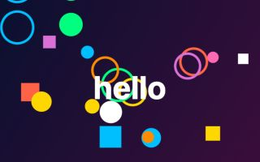

The whole picture shakes. Set strength when something hits, and let it fall away.

| JavaScript | Python |
|---|---|
| `shake(10)` | `shake(10)` |

| Setting | In Python | Starts at | Can be |
|---|---|---|---|
| `strength` | `strength` | `10` | 0 to 200 |
| `speed` | `speed` | `25` | 1 to 100 |
| `amount` | `amount` | `1` | 0 to 1 |

### punch

A zoom in towards a point. Tie its strength to the beat.

| JavaScript | Python |
|---|---|
| `punch(0.15)` | `punch(0.15)` |

| Setting | In Python | Starts at | Can be |
|---|---|---|---|
| `strength` | `strength` | `0.15` | -0.9 to 4 |
| `x` | `x` | the middle | a place in the scene |
| `y` | `y` | the middle | a place in the scene |
| `amount` | `amount` | `1` | 0 to 1 |

## Blur and light

### zoomBlur

Rushing towards a point.

| JavaScript | Python |
|---|---|
| `zoomBlur(0.25)` | `zoom_blur(0.25)` |

| Setting | In Python | Starts at | Can be |
|---|---|---|---|
| `strength` | `strength` | `0.25` | 0 to 1 |
| `x` | `x` | the middle | a place in the scene |
| `y` | `y` | the middle | a place in the scene |
| `amount` | `amount` | `1` | 0 to 1 |

### spinBlur

Spinning round a point.

| JavaScript | Python |
|---|---|
| `spinBlur(8)` | `spin_blur(8)` |

| Setting | In Python | Starts at | Can be |
|---|---|---|---|
| `angle` | `angle` | `8` | -90 to 90 degrees |
| `x` | `x` | the middle | a place in the scene |
| `y` | `y` | the middle | a place in the scene |
| `amount` | `amount` | `1` | 0 to 1 |

### motionBlur

Moving fast in one direction.

| JavaScript | Python |
|---|---|
| `motionBlur(24)` | `motion_blur(24)` |

It looks at a dozen or more places for every pixel, so it costs a little more than most.

| Setting | In Python | Starts at | Can be |
|---|---|---|---|
| `size` | `size` | `24` | 0 to 300 |
| `angle` | `angle` | `0` | -360 to 360 degrees |
| `amount` | `amount` | `1` | 0 to 1 |

### tiltShift

A band in focus and the rest blurred, which makes a scene look like a tiny model.

| JavaScript | Python |
|---|---|
| `tiltShift(8)` | `tilt_shift(8)` |

It looks at a dozen or more places for every pixel, so it costs a little more than most.

| Setting | In Python | Starts at | Can be |
|---|---|---|---|
| `strength` | `strength` | `8` | 0 to 60 |
| `size` | `size` | `70` | 5 to 1000 |
| `y` | `y` | the middle | a place in the scene |
| `amount` | `amount` | `1` | 0 to 1 |

### lightRays

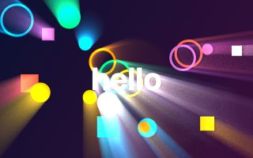

Rays of light streaming out from a point, through whatever is bright.

| JavaScript | Python |
|---|---|
| `lightRays(0.7)` | `light_rays(0.7)` |

Also called `godRays`.

It looks at a dozen or more places for every pixel, so it costs a little more than most.

| Setting | In Python | Starts at | Can be |
|---|---|---|---|
| `strength` | `strength` | `0.7` | 0 to 3 |
| `size` | `size` | `0.6` | 0 to 1 |
| `threshold` | `threshold` | `0.6` | 0 to 1 |
| `x` | `x` | the middle | a place in the scene |
| `y` | `y` | the middle | a place in the scene |
| `amount` | `amount` | `1` | 0 to 1 |

### streaks

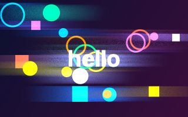

Long sideways flares from bright lights, as a film camera makes.

| JavaScript | Python |
|---|---|
| `streaks(0.6)` | `streaks(0.6)` |

It looks at a dozen or more places for every pixel, so it costs a little more than most.

| Setting | In Python | Starts at | Can be |
|---|---|---|---|
| `strength` | `strength` | `0.6` | 0 to 3 |
| `size` | `size` | `120` | 0 to 800 |
| `threshold` | `threshold` | `0.6` | 0 to 1 |
| `colour` | `colour` | `"#88aaff"` | any colour |
| `amount` | `amount` | `1` | 0 to 1 |

### softFocus

A soft, dreamy haze over the bright parts.

| JavaScript | Python |
|---|---|
| `softFocus(0.6)` | `soft_focus(0.6)` |

| Setting | In Python | Starts at | Can be |
|---|---|---|---|
| `strength` | `strength` | `0.6` | 0 to 1 |
| `size` | `size` | `6` | 0 to 60 |
| `amount` | `amount` | `1` | 0 to 1 |

### blur

Out of focus.

| JavaScript | Python |
|---|---|
| `blur(8)` | `blur(8)` |

It looks at a dozen or more places for every pixel, so it costs a little more than most.

| Setting | In Python | Starts at | Can be |
|---|---|---|---|
| `radius` | `radius` | `8` | 0 to 200 |
| `amount` | `amount` | `1` | 0 to 1 |

### glow

Bright things shine and spread light around them.

| JavaScript | Python |
|---|---|
| `glow(0.8)` | `glow(0.8)` |

Also called `bloom`.

It looks at a dozen or more places for every pixel, so it costs a little more than most.

| Setting | In Python | Starts at | Can be |
|---|---|---|---|
| `strength` | `strength` | `0.8` | 0 to 4 |
| `threshold` | `threshold` | `0.5` | 0 to 1 |
| `radius` | `radius` | `24` | 2 to 200 |
| `amount` | `amount` | `1` | 0 to 1 |

## What was drawn stays

### smear

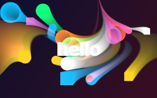

What was drawn is carried away on a slow current, like wet paint.

| JavaScript | Python |
|---|---|
| `smear(3)` | `smear(3)` |

It keeps its own last frame, so it wants a scene that moves.

| Setting | In Python | Starts at | Can be |
|---|---|---|---|
| `length` | `length` | `3` | 0 to 30 |
| `size` | `size` | `40` | 0 to 400 |
| `scale` | `scale` | `150` | 20 to 1000 |
| `amount` | `amount` | `1` | 0 to 1 |

### stutter

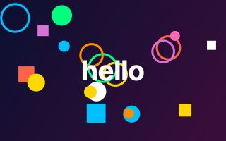

Only so many new pictures a second: the last one is held between them.

| JavaScript | Python |
|---|---|
| `stutter(8)` | `stutter(8)` |

It keeps its own last frame, so it wants a scene that moves.

| Setting | In Python | Starts at | Can be |
|---|---|---|---|
| `speed` | `speed` | `8` | 0.5 to 60 |
| `amount` | `amount` | `1` | 0 to 1 |

### trails

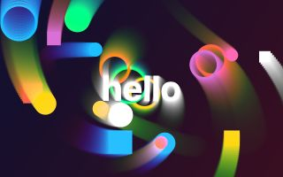

What was drawn stays and fades. With zoom, spin and hue it becomes the classic screensaver tunnel.

| JavaScript | Python |
|---|---|
| `trails(0.5)` | `trails(0.5)` |

It looks at a dozen or more places for every pixel, so it costs a little more than most.

It keeps its own last frame, so it wants a scene that moves.

| Setting | In Python | Starts at | Can be |
|---|---|---|---|
| `length` | `length` | `0.5` | 0 to 20 seconds |
| `zoom` | `zoom` | `1` | 0.1 to 10 |
| `spin` | `spin` | `0` | -720 to 720 degrees |
| `hue` | `hue` | `0` | -720 to 720 degrees |
| `dx` | `dx` | `0` | -2000 to 2000 |
| `dy` | `dy` | `0` | -2000 to 2000 |
| `x` | `x` | the middle | a place in the scene |
| `y` | `y` | the middle | a place in the scene |
| `amount` | `amount` | `1` | 0 to 1 |

## Colours

### rgbSplit

Red and blue pulled apart, like a cheap lens or a bad signal.

| JavaScript | Python |
|---|---|
| `rgbSplit(4)` | `rgb_split(4)` |

| Setting | In Python | Starts at | Can be |
|---|---|---|---|
| `size` | `size` | `4` | 0 to 60 |
| `angle` | `angle` | `0` | -360 to 360 degrees |
| `spread` | `spread` | `false` | true or false |
| `amount` | `amount` | `1` | 0 to 1 |

### hue

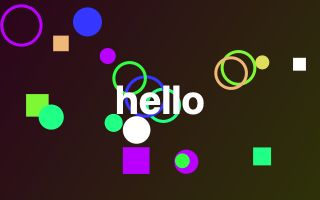

Every colour moved round the colour wheel. With speed, the colours keep turning.

| JavaScript | Python |
|---|---|
| `hue(90)` | `hue(90)` |

| Setting | In Python | Starts at | Can be |
|---|---|---|---|
| `shift` | `shift` | `90` | -360 to 360 degrees |
| `speed` | `speed` | `0` | -720 to 720 |
| `amount` | `amount` | `1` | 0 to 1 |

### saturate

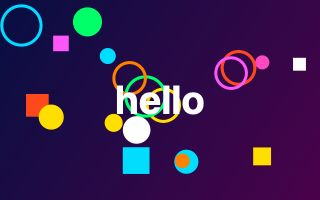

More colour, or less: at 0 the picture is grey.

| JavaScript | Python |
|---|---|
| `saturate(1.6)` | `saturate(1.6)` |

| Setting | In Python | Starts at | Can be |
|---|---|---|---|
| `strength` | `strength` | `1.6` | 0 to 4 |
| `amount` | `amount` | `1` | 0 to 1 |

### brighten

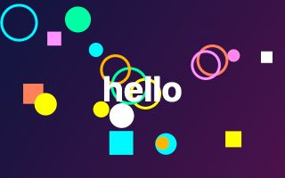

Brighter, or darker below 1.

| JavaScript | Python |
|---|---|
| `brighten(1.3)` | `brighten(1.3)` |

| Setting | In Python | Starts at | Can be |
|---|---|---|---|
| `strength` | `strength` | `1.3` | 0 to 4 |
| `amount` | `amount` | `1` | 0 to 1 |

### contrast

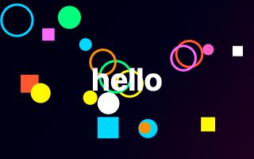

Lights lighter and darks darker.

| JavaScript | Python |
|---|---|
| `contrast(1.4)` | `contrast(1.4)` |

| Setting | In Python | Starts at | Can be |
|---|---|---|---|
| `strength` | `strength` | `1.4` | 0 to 4 |
| `amount` | `amount` | `1` | 0 to 1 |

### invert

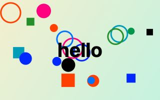

A negative: every colour swapped for its opposite.

| JavaScript | Python |
|---|---|
| `invert()` | `invert()` |

| Setting | In Python | Starts at | Can be |
|---|---|---|---|
| `amount` | `amount` | `1` | 0 to 1 |

### posterize

Only a few shades of each colour, like a poster.

| JavaScript | Python |
|---|---|
| `posterize(4)` | `posterize(4)` |

| Setting | In Python | Starts at | Can be |
|---|---|---|---|
| `levels` | `levels` | `4` | 2 to 16, a whole number |
| `amount` | `amount` | `1` | 0 to 1 |

### tint

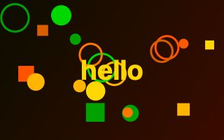

Seen through coloured glass.

| JavaScript | Python |
|---|---|
| `tint("gold")` | `tint("gold")` |

| Setting | In Python | Starts at | Can be |
|---|---|---|---|
| `colour` | `colour` | `"gold"` | any colour |
| `amount` | `amount` | `1` | 0 to 1 |

### duotone

Two colours only: one for the dark parts and one for the light.

| JavaScript | Python |
|---|---|
| `duotone("midnightblue", "gold")` | `duotone("midnightblue", "gold")` |

| Setting | In Python | Starts at | Can be |
|---|---|---|---|
| `dark` | `dark` | `"midnightblue"` | any colour |
| `light` | `light` | `"gold"` | any colour |
| `amount` | `amount` | `1` | 0 to 1 |

### colourCycle

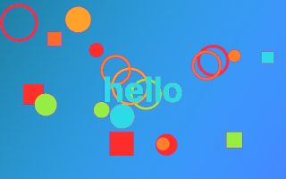

Brightness becomes a colour from a palette, and the colours move round.

| JavaScript | Python |
|---|---|
| `colourCycle("rainbow")` | `colour_cycle("rainbow")` |

Also called `colorCycle`.

| Setting | In Python | Starts at | Can be |
|---|---|---|---|
| `palette` | `palette` | `"rainbow"` | a palette's name, or a list of colours |
| `speed` | `speed` | `0.3` | -5 to 5 |
| `bands` | `bands` | `1` | 0.1 to 8 |
| `amount` | `amount` | `1` | 0 to 1 |

### gradientMap

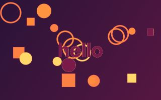

Brightness becomes a colour from a palette, dark to light.

| JavaScript | Python |
|---|---|
| `gradientMap("sunset")` | `gradient_map("sunset")` |

| Setting | In Python | Starts at | Can be |
|---|---|---|---|
| `palette` | `palette` | `"sunset"` | a palette's name, or a list of colours |
| `amount` | `amount` | `1` | 0 to 1 |

### thermal

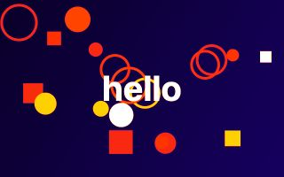

A heat camera: cold is dark blue, hot is yellow and white.

| JavaScript | Python |
|---|---|
| `thermal()` | `thermal()` |

| Setting | In Python | Starts at | Can be |
|---|---|---|---|
| `palette` | `palette` | `"thermal"` | a palette's name, or a list of colours |
| `amount` | `amount` | `1` | 0 to 1 |

### nightVision

Green, grainy and bright in the dark, like a night-vision scope.

| JavaScript | Python |
|---|---|
| `nightVision(1.6)` | `night_vision(1.6)` |

| Setting | In Python | Starts at | Can be |
|---|---|---|---|
| `strength` | `strength` | `1.6` | 0 to 6 |
| `amount` | `amount` | `1` | 0 to 1 |

### sepia

The warm brown of an old photograph.

| JavaScript | Python |
|---|---|
| `sepia(1)` | `sepia(1)` |

| Setting | In Python | Starts at | Can be |
|---|---|---|---|
| `strength` | `strength` | `1` | 0 to 1 |
| `amount` | `amount` | `1` | 0 to 1 |

### threshold

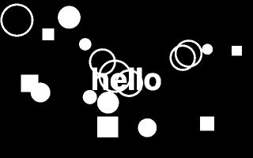

Two colours and nothing between: dark or light.

| JavaScript | Python |
|---|---|
| `threshold(0.5)` | `threshold(0.5)` |

| Setting | In Python | Starts at | Can be |
|---|---|---|---|
| `level` | `level` | `0.5` | 0 to 1 |
| `dark` | `dark` | `"black"` | any colour |
| `light` | `light` | `"white"` | any colour |
| `amount` | `amount` | `1` | 0 to 1 |

### solarize

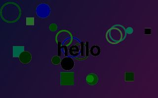

The bright parts turned to their opposite, as in an over-exposed photograph.

| JavaScript | Python |
|---|---|
| `solarize(0.5)` | `solarize(0.5)` |

| Setting | In Python | Starts at | Can be |
|---|---|---|---|
| `level` | `level` | `0.5` | 0 to 1 |
| `amount` | `amount` | `1` | 0 to 1 |

### colourBleed

Colours smeared sideways, as on old videotape.

| JavaScript | Python |
|---|---|
| `colourBleed(10)` | `colour_bleed(10)` |

Also called `colorBleed`.

| Setting | In Python | Starts at | Can be |
|---|---|---|---|
| `size` | `size` | `10` | 0 to 100 |
| `amount` | `amount` | `1` | 0 to 1 |

### rainbowEdges

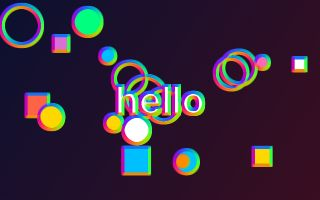

Every edge in the picture drawn in rainbow colours.

| JavaScript | Python |
|---|---|
| `rainbowEdges(2)` | `rainbow_edges(2)` |

| Setting | In Python | Starts at | Can be |
|---|---|---|---|
| `strength` | `strength` | `2` | 0 to 10 |
| `size` | `size` | `1.5` | 0.5 to 20 |
| `speed` | `speed` | `0.1` | -5 to 5 |
| `amount` | `amount` | `1` | 0 to 1 |

## Screens and old computers

### scanlines

Dark lines across the picture, as on an old screen.

| JavaScript | Python |
|---|---|
| `scanlines(0.5)` | `scanlines(0.5)` |

| Setting | In Python | Starts at | Can be |
|---|---|---|---|
| `strength` | `strength` | `0.5` | 0 to 1 |
| `size` | `size` | `3` | 1 to 40 |
| `amount` | `amount` | `1` | 0 to 1 |

### crt

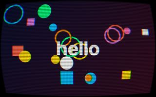

An old television: curved glass, lines, and thin stripes of red, green and blue.

| JavaScript | Python |
|---|---|
| `crt(0.18)` | `crt(0.18)` |

| Setting | In Python | Starts at | Can be |
|---|---|---|---|
| `curve` | `curve` | `0.18` | 0 to 1 |
| `lines` | `lines` | `0.45` | 0 to 1 |
| `size` | `size` | `3` | 1 to 40 |
| `amount` | `amount` | `1` | 0 to 1 |

### glitch

A broken signal: blocks that jump sideways, a line that tears, a band of snow.

| JavaScript | Python |
|---|---|
| `glitch(0.5)` | `glitch(0.5)` |

| Setting | In Python | Starts at | Can be |
|---|---|---|---|
| `strength` | `strength` | `0.5` | 0 to 1 |
| `speed` | `speed` | `1` | 0 to 10 |
| `seed` | `seed` | `1` | 0 to 9999, a whole number |
| `amount` | `amount` | `1` | 0 to 1 |

### letters

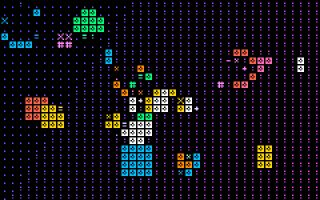

The picture made of marks, as an old terminal would show it.

| JavaScript | Python |
|---|---|
| `letters(10)` | `letters(10)` |

| Setting | In Python | Starts at | Can be |
|---|---|---|---|
| `size` | `size` | `10` | 4 to 100 |
| `colour` | `colour` | `"white"` | any colour |
| `own` | `own` | `true` | true or false |
| `amount` | `amount` | `1` | 0 to 1 |

### dither

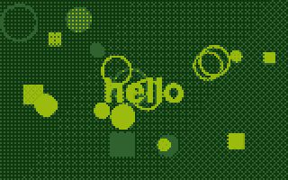

A few colours made to pass for many with a pattern of dots, as old computers did.

| JavaScript | Python |
|---|---|
| `dither("gameboy")` | `dither("gameboy")` |

| Setting | In Python | Starts at | Can be |
|---|---|---|---|
| `palette` | `palette` | `"gameboy"` | a palette's name, or a list of colours |
| `size` | `size` | `2` | 1 to 40 |
| `strength` | `strength` | `0.35` | 0 to 1 |
| `amount` | `amount` | `1` | 0 to 1 |

### interlace

Every other line dark, swapping each frame, like old video.

| JavaScript | Python |
|---|---|
| `interlace(0.6)` | `interlace(0.6)` |

| Setting | In Python | Starts at | Can be |
|---|---|---|---|
| `strength` | `strength` | `0.6` | 0 to 1 |
| `size` | `size` | `2` | 1 to 20 |
| `amount` | `amount` | `1` | 0 to 1 |

### led

A wall of round lamps.

| JavaScript | Python |
|---|---|
| `led(8)` | `led(8)` |

| Setting | In Python | Starts at | Can be |
|---|---|---|---|
| `size` | `size` | `8` | 3 to 80 |
| `amount` | `amount` | `1` | 0 to 1 |

## Drawn, printed and painted

### edges

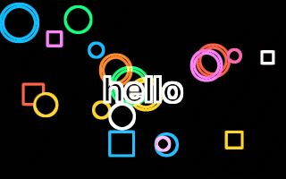

Only the outlines, each in its own colour.

| JavaScript | Python |
|---|---|
| `edges(2)` | `edges(2)` |

| Setting | In Python | Starts at | Can be |
|---|---|---|---|
| `strength` | `strength` | `2` | 0 to 10 |
| `size` | `size` | `1.5` | 0.5 to 20 |
| `fill` | `fill` | `0` | 0 to 1 |
| `amount` | `amount` | `1` | 0 to 1 |

### dots

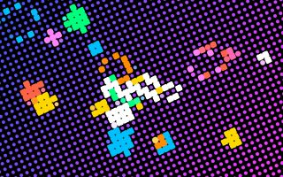

Printed in dots, big where the picture is bright, as a comic or a newspaper is.

| JavaScript | Python |
|---|---|
| `dots(9)` | `dots(9)` |

Also called `halftone`.

| Setting | In Python | Starts at | Can be |
|---|---|---|---|
| `size` | `size` | `9` | 2 to 100 |
| `angle` | `angle` | `25` | -360 to 360 degrees |
| `paper` | `paper` | `"black"` | any colour |
| `amount` | `amount` | `1` | 0 to 1 |

### emboss

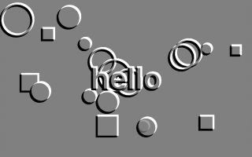

Pressed into grey metal: only the bumps and hollows show.

| JavaScript | Python |
|---|---|
| `emboss(2)` | `emboss(2)` |

| Setting | In Python | Starts at | Can be |
|---|---|---|---|
| `strength` | `strength` | `2` | 0 to 10 |
| `angle` | `angle` | `135` | -360 to 360 degrees |
| `size` | `size` | `1.5` | 0.5 to 20 |
| `amount` | `amount` | `1` | 0 to 1 |

### sharpen

Crisper edges.

| JavaScript | Python |
|---|---|
| `sharpen(1)` | `sharpen(1)` |

| Setting | In Python | Starts at | Can be |
|---|---|---|---|
| `strength` | `strength` | `1` | 0 to 5 |
| `size` | `size` | `1` | 0.5 to 10 |
| `amount` | `amount` | `1` | 0 to 1 |

### sketch

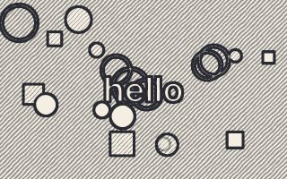

A pencil drawing on paper.

| JavaScript | Python |
|---|---|
| `sketch(3)` | `sketch(3)` |

| Setting | In Python | Starts at | Can be |
|---|---|---|---|
| `strength` | `strength` | `3` | 0 to 10 |
| `size` | `size` | `1.2` | 0.5 to 20 |
| `paper` | `paper` | `"#f4efe2"` | any colour |
| `colour` | `colour` | `"#2a2a33"` | any colour |
| `amount` | `amount` | `1` | 0 to 1 |

### cartoon

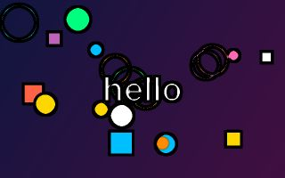

Flat colours and black outlines.

| JavaScript | Python |
|---|---|
| `cartoon(4)` | `cartoon(4)` |

| Setting | In Python | Starts at | Can be |
|---|---|---|---|
| `levels` | `levels` | `4` | 2 to 12, a whole number |
| `strength` | `strength` | `2.5` | 0 to 10 |
| `size` | `size` | `1.5` | 0.5 to 20 |
| `amount` | `amount` | `1` | 0 to 1 |

### stainedGlass

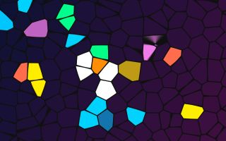

Pieces of coloured glass with dark lead between them.

| JavaScript | Python |
|---|---|
| `stainedGlass(40)` | `stained_glass(40)` |

| Setting | In Python | Starts at | Can be |
|---|---|---|---|
| `size` | `size` | `40` | 8 to 400 |
| `colour` | `colour` | `"#101010"` | any colour |
| `amount` | `amount` | `1` | 0 to 1 |

### crosshatch

Shaded with crossing pen lines: more lines where it is darker.

| JavaScript | Python |
|---|---|
| `crosshatch(6)` | `crosshatch(6)` |

| Setting | In Python | Starts at | Can be |
|---|---|---|---|
| `size` | `size` | `6` | 2 to 60 |
| `colour` | `colour` | `"#1a1a22"` | any colour |
| `paper` | `paper` | `"#f6f2e8"` | any colour |
| `amount` | `amount` | `1` | 0 to 1 |

### oil

Smoothed into patches of colour, like oil paint. Heavy: it looks at 36 places for every pixel.

| JavaScript | Python |
|---|---|
| `oil(4)` | `oil(4)` |

**Heavy.** It looks at dozens of places for every pixel: use it alone, or at a lower `effectsQuality`.

| Setting | In Python | Starts at | Can be |
|---|---|---|---|
| `size` | `size` | `4` | 1 to 30 |
| `amount` | `amount` | `1` | 0 to 1 |

## In front of the picture

### grain

The fine speckle of film.

| JavaScript | Python |
|---|---|
| `grain(0.18)` | `grain(0.18)` |

| Setting | In Python | Starts at | Can be |
|---|---|---|---|
| `strength` | `strength` | `0.18` | 0 to 1 |
| `size` | `size` | `1.5` | 0.5 to 20 |
| `seed` | `seed` | `1` | 0 to 9999, a whole number |
| `amount` | `amount` | `1` | 0 to 1 |

### vignette

Dark corners, which draw the eye to the middle.

| JavaScript | Python |
|---|---|
| `vignette(0.6)` | `vignette(0.6)` |

| Setting | In Python | Starts at | Can be |
|---|---|---|---|
| `strength` | `strength` | `0.6` | 0 to 1 |
| `size` | `size` | `0.75` | 0 to 2 |
| `colour` | `colour` | `"black"` | any colour |
| `amount` | `amount` | `1` | 0 to 1 |

### dust

Specks and scratches, as on old film.

| JavaScript | Python |
|---|---|
| `dust(0.5)` | `dust(0.5)` |

| Setting | In Python | Starts at | Can be |
|---|---|---|---|
| `strength` | `strength` | `0.5` | 0 to 1 |
| `seed` | `seed` | `1` | 0 to 9999, a whole number |
| `amount` | `amount` | `1` | 0 to 1 |

### lightLeaks

Warm light creeping in from the sides, as in an old camera.

| JavaScript | Python |
|---|---|
| `lightLeaks(0.6)` | `light_leaks(0.6)` |

| Setting | In Python | Starts at | Can be |
|---|---|---|---|
| `strength` | `strength` | `0.6` | 0 to 2 |
| `speed` | `speed` | `0.2` | -5 to 5 |
| `colour` | `colour` | `"#ff7a2a"` | any colour |
| `amount` | `amount` | `1` | 0 to 1 |

### rain

Rain falling in front of the picture.

| JavaScript | Python |
|---|---|
| `rain(0.6)` | `rain(0.6)` |

| Setting | In Python | Starts at | Can be |
|---|---|---|---|
| `strength` | `strength` | `0.6` | 0 to 2 |
| `speed` | `speed` | `1` | 0 to 5 |
| `angle` | `angle` | `12` | -80 to 80 degrees |
| `amount` | `amount` | `1` | 0 to 1 |

### snow

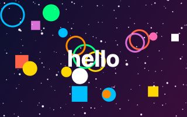

Snow falling in front of the picture.

| JavaScript | Python |
|---|---|
| `snow(0.8)` | `snow(0.8)` |

| Setting | In Python | Starts at | Can be |
|---|---|---|---|
| `strength` | `strength` | `0.8` | 0 to 2 |
| `speed` | `speed` | `1` | 0 to 5 |
| `size` | `size` | `3` | 0.5 to 20 |
| `amount` | `amount` | `1` | 0 to 1 |

### bokeh

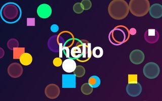

Soft discs of coloured light drifting by: lamps out of focus.

| JavaScript | Python |
|---|---|
| `bokeh(0.5)` | `bokeh(0.5)` |

| Setting | In Python | Starts at | Can be |
|---|---|---|---|
| `strength` | `strength` | `0.5` | 0 to 2 |
| `size` | `size` | `30` | 4 to 200 |
| `speed` | `speed` | `0.3` | -5 to 5 |
| `amount` | `amount` | `1` | 0 to 1 |

### fog

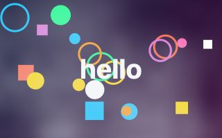

Drifting mist, thicker towards the bottom.

| JavaScript | Python |
|---|---|
| `fog(0.6)` | `fog(0.6)` |

| Setting | In Python | Starts at | Can be |
|---|---|---|---|
| `strength` | `strength` | `0.6` | 0 to 1 |
| `speed` | `speed` | `0.3` | -5 to 5 |
| `scale` | `scale` | `220` | 20 to 2000 |
| `colour` | `colour` | `"#dfe6ee"` | any colour |
| `amount` | `amount` | `1` | 0 to 1 |

### lightning

A flash, now and then.

| JavaScript | Python |
|---|---|
| `lightning(1)` | `lightning(1)` |

| Setting | In Python | Starts at | Can be |
|---|---|---|---|
| `strength` | `strength` | `1` | 0 to 3 |
| `speed` | `speed` | `1` | 0 to 10 |
| `seed` | `seed` | `1` | 0 to 9999, a whole number |
| `amount` | `amount` | `1` | 0 to 1 |

## Backdrops that need no drawing

A backdrop is a picture the graphics card makes by itself. It is behind whatever you draw, and shows wherever you have left the canvas clear: wipe the picture each frame with `background()` (no colour) rather than painting over it.

### plasma

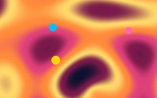

Slow rolling colour.

| JavaScript | Python |
|---|---|
| `plasma("sunset")` | `plasma("sunset")` |

| Setting | In Python | Starts at | Can be |
|---|---|---|---|
| `palette` | `palette` | `"sunset"` | a palette's name, or a list of colours |
| `speed` | `speed` | `0.3` | -5 to 5 |
| `scale` | `scale` | `1` | 0.1 to 10 |
| `amount` | `amount` | `1` | 0 to 1 |

### starfield

Flying through stars.

| JavaScript | Python |
|---|---|
| `starfield(0.5)` | `starfield(0.5)` |

| Setting | In Python | Starts at | Can be |
|---|---|---|---|
| `speed` | `speed` | `0.5` | -5 to 5 |
| `stars` | `stars` | `1` | 0 to 4 |
| `colour` | `colour` | `"white"` | any colour |
| `x` | `x` | the middle | a place in the scene |
| `y` | `y` | the middle | a place in the scene |
| `amount` | `amount` | `1` | 0 to 1 |

### metaballs

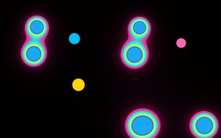

Blobs that melt into each other when they meet: a lava lamp.

| JavaScript | Python |
|---|---|
| `metaballs("neon")` | `metaballs("neon")` |

| Setting | In Python | Starts at | Can be |
|---|---|---|---|
| `palette` | `palette` | `"neon"` | a palette's name, or a list of colours |
| `speed` | `speed` | `0.5` | -5 to 5 |
| `count` | `count` | `7` | 1 to 12, a whole number |
| `size` | `size` | `1` | 0.2 to 4 |
| `amount` | `amount` | `1` | 0 to 1 |

### flow

Colour that folds and curls like ink in water.

| JavaScript | Python |
|---|---|
| `flow("ocean")` | `flow("ocean")` |

| Setting | In Python | Starts at | Can be |
|---|---|---|---|
| `palette` | `palette` | `"ocean"` | a palette's name, or a list of colours |
| `speed` | `speed` | `0.2` | -5 to 5 |
| `scale` | `scale` | `1` | 0.1 to 10 |
| `amount` | `amount` | `1` | 0 to 1 |

### warp

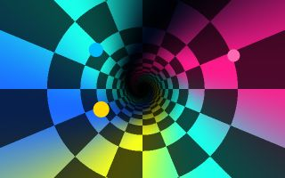

A chequered tunnel rushing past.

| JavaScript | Python |
|---|---|
| `warp("neon")` | `warp("neon")` |

| Setting | In Python | Starts at | Can be |
|---|---|---|---|
| `palette` | `palette` | `"neon"` | a palette's name, or a list of colours |
| `speed` | `speed` | `1` | -10 to 10 |
| `x` | `x` | the middle | a place in the scene |
| `y` | `y` | the middle | a place in the scene |
| `amount` | `amount` | `1` | 0 to 1 |

### voronoi

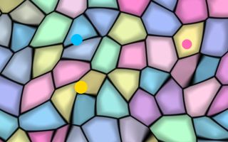

Soft coloured cells that slowly shift.

| JavaScript | Python |
|---|---|
| `voronoi("candy")` | `voronoi("candy")` |

| Setting | In Python | Starts at | Can be |
|---|---|---|---|
| `palette` | `palette` | `"candy"` | a palette's name, or a list of colours |
| `speed` | `speed` | `0.3` | -5 to 5 |
| `scale` | `scale` | `1` | 0.1 to 10 |
| `amount` | `amount` | `1` | 0 to 1 |

### moire

Two sets of rings crossing, making patterns neither has alone.

| JavaScript | Python |
|---|---|
| `moire("white")` | `moire("white")` |

| Setting | In Python | Starts at | Can be |
|---|---|---|---|
| `colour` | `colour` | `"white"` | any colour |
| `speed` | `speed` | `0.3` | -5 to 5 |
| `scale` | `scale` | `1` | 0.1 to 10 |
| `amount` | `amount` | `1` | 0 to 1 |

### interference

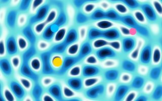

Waves from four moving points, crossing.

| JavaScript | Python |
|---|---|
| `interference("ocean")` | `interference("ocean")` |

| Setting | In Python | Starts at | Can be |
|---|---|---|---|
| `palette` | `palette` | `"ocean"` | a palette's name, or a list of colours |
| `speed` | `speed` | `0.5` | -5 to 5 |
| `scale` | `scale` | `1` | 0.1 to 10 |
| `amount` | `amount` | `1` | 0 to 1 |

### aurora

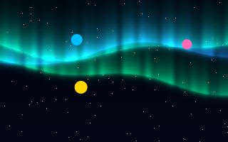

The northern lights over a night sky.

| JavaScript | Python |
|---|---|
| `aurora("aurora")` | `aurora("aurora")` |

| Setting | In Python | Starts at | Can be |
|---|---|---|---|
| `palette` | `palette` | `"aurora"` | a palette's name, or a list of colours |
| `speed` | `speed` | `0.3` | -5 to 5 |
| `amount` | `amount` | `1` | 0 to 1 |

### fire

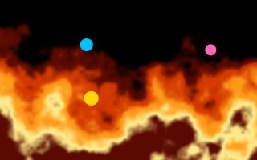

Flames rising from the bottom of the picture.

| JavaScript | Python |
|---|---|
| `fire("fire")` | `fire("fire")` |

| Setting | In Python | Starts at | Can be |
|---|---|---|---|
| `palette` | `palette` | `"fire"` | a palette's name, or a list of colours |
| `speed` | `speed` | `1` | -5 to 5 |
| `scale` | `scale` | `1` | 0.1 to 10 |
| `amount` | `amount` | `1` | 0 to 1 |

### clouds

A sky with drifting clouds.

| JavaScript | Python |
|---|---|
| `clouds("#3a8fdc")` | `clouds("#3a8fdc")` |

| Setting | In Python | Starts at | Can be |
|---|---|---|---|
| `colour` | `colour` | `"#3a8fdc"` | any colour |
| `speed` | `speed` | `0.1` | -5 to 5 |
| `scale` | `scale` | `1` | 0.1 to 10 |
| `amount` | `amount` | `1` | 0 to 1 |

### matrixRain

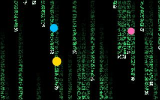

Green marks falling in columns.

| JavaScript | Python |
|---|---|
| `matrixRain("#3dff7a")` | `matrix_rain("#3dff7a")` |

| Setting | In Python | Starts at | Can be |
|---|---|---|---|
| `colour` | `colour` | `"#3dff7a"` | any colour |
| `speed` | `speed` | `1` | 0 to 10 |
| `size` | `size` | `14` | 6 to 80 |
| `amount` | `amount` | `1` | 0 to 1 |

### copperBars

Shining bars sliding up and down: a demo-scene classic.

| JavaScript | Python |
|---|---|
| `copperBars("rainbow")` | `copper_bars("rainbow")` |

| Setting | In Python | Starts at | Can be |
|---|---|---|---|
| `palette` | `palette` | `"rainbow"` | a palette's name, or a list of colours |
| `count` | `count` | `5` | 1 to 8, a whole number |
| `speed` | `speed` | `1` | -5 to 5 |
| `size` | `size` | `34` | 4 to 300 |
| `amount` | `amount` | `1` | 0 to 1 |

### checkerFloor

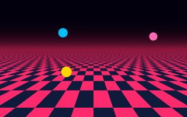

A chequered floor rushing towards you under a glowing horizon.

| JavaScript | Python |
|---|---|
| `checkerFloor("#ff2a6d")` | `checker_floor("#ff2a6d")` |

| Setting | In Python | Starts at | Can be |
|---|---|---|---|
| `colour` | `colour` | `"#ff2a6d"` | any colour |
| `dark` | `dark` | `"#101a3a"` | any colour |
| `speed` | `speed` | `1` | -10 to 10 |
| `amount` | `amount` | `1` | 0 to 1 |

### twister

A twisting four-sided bar, another demo-scene classic.

| JavaScript | Python |
|---|---|
| `twister("candy")` | `twister("candy")` |

| Setting | In Python | Starts at | Can be |
|---|---|---|---|
| `palette` | `palette` | `"candy"` | a palette's name, or a list of colours |
| `speed` | `speed` | `1` | -5 to 5 |
| `size` | `size` | `0.22` | 0.02 to 0.5 |
| `amount` | `amount` | `1` | 0 to 1 |

## The music, drawn

These follow the sound: see Music in the README. With nothing to listen to they are still and dark.

### spectrumBars

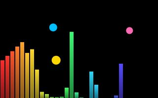

The music as bars: low notes at the left, high at the right.

| JavaScript | Python |
|---|---|
| `spectrumBars("rainbow")` | `spectrum_bars("rainbow")` |

| Setting | In Python | Starts at | Can be |
|---|---|---|---|
| `palette` | `palette` | `"rainbow"` | a palette's name, or a list of colours |
| `count` | `count` | `32` | 4 to 64, a whole number |
| `size` | `size` | `0.7` | 0.05 to 1 |
| `amount` | `amount` | `1` | 0 to 1 |

### spectrumRing

The music as bars round a ring.

| JavaScript | Python |
|---|---|
| `spectrumRing("rainbow")` | `spectrum_ring("rainbow")` |

| Setting | In Python | Starts at | Can be |
|---|---|---|---|
| `palette` | `palette` | `"rainbow"` | a palette's name, or a list of colours |
| `size` | `size` | `90` | 10 to 1000 |
| `x` | `x` | the middle | a place in the scene |
| `y` | `y` | the middle | a place in the scene |
| `amount` | `amount` | `1` | 0 to 1 |

### waveformRing

The sound's own wave, bent into a ring.

| JavaScript | Python |
|---|---|
| `waveformRing("white")` | `waveform_ring("white")` |

| Setting | In Python | Starts at | Can be |
|---|---|---|---|
| `colour` | `colour` | `"white"` | any colour |
| `size` | `size` | `110` | 10 to 1000 |
| `strength` | `strength` | `3` | 0.5 to 40 |
| `x` | `x` | the middle | a place in the scene |
| `y` | `y` | the middle | a place in the scene |
| `amount` | `amount` | `1` | 0 to 1 |

### beatFlash

A flash of colour on each beat.

| JavaScript | Python |
|---|---|
| `beatFlash(0.5)` | `beat_flash(0.5)` |

| Setting | In Python | Starts at | Can be |
|---|---|---|---|
| `strength` | `strength` | `0.5` | 0 to 2 |
| `colour` | `colour` | `"white"` | any colour |
| `amount` | `amount` | `1` | 0 to 1 |

### bassShake

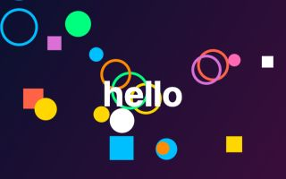

The picture shakes with the bass.

| JavaScript | Python |
|---|---|
| `bassShake(14)` | `bass_shake(14)` |

| Setting | In Python | Starts at | Can be |
|---|---|---|---|
| `strength` | `strength` | `14` | 0 to 200 |
| `speed` | `speed` | `25` | 1 to 100 |
| `amount` | `amount` | `1` | 0 to 1 |

## Looks

A look is several effects at once: `look("dream")`. It gives its parts back by name (`look("vhs").glitch.strength = 1`), and has `amount`, `off()`, `on()` and `remove()` for the lot.

### look: dream

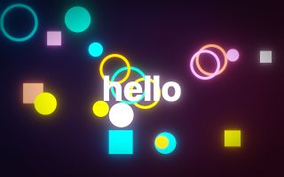

Soft, glowing and rich.

`look("dream")` is `glow({ strength: 1, threshold: 0.35, radius: 40 })`, then `saturate({ strength: 1.3 })`, then `vignette({ strength: 0.5 })`.

### look: arcade

The curved glass of an old arcade machine.

`look("arcade")` is `glow({ strength: 0.7, threshold: 0.4, radius: 20 })`, then `crt({ curve: 0.2, lines: 0.5 })`.

### look: vhs

A worn videotape.

`look("vhs")` is `saturate({ strength: 1.35 })`, then `rgbSplit({ size: 3 })`, then `glitch({ strength: 0.35 })`, then `scanlines({ strength: 0.3, size: 4 })`, then `grain({ strength: 0.2, size: 2 })`, then `vignette({ strength: 0.45 })`.

### look: neon

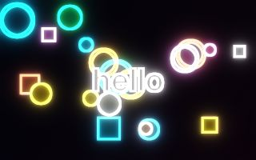

Glowing outlines in the dark.

`look("neon")` is `edges({ strength: 3, fill: 0.15 })`, then `glow({ strength: 1.4, threshold: 0.2, radius: 28 })`.

### look: comic

A few flat colours, printed in dots.

`look("comic")` is `posterize({ levels: 4 })`, then `dots({ size: 7 })`.

### look: underwater

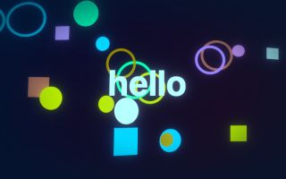

Blue, wobbling and dim at the edges.

`look("underwater")` is `wobble({ size: 10, scale: 160 })`, then `tint({ colour: "#7fd4ff" })`, then `glow({ strength: 0.5, threshold: 0.5 })`, then `vignette({ strength: 0.6, colour: "#001830" })`.

### look: oldfilm

Brown, grainy and dark at the corners.

`look("oldfilm")` is `duotone({ dark: "#1a1208", light: "#f2e2c0" })`, then `grain({ strength: 0.3, size: 2 })`, then `vignette({ strength: 0.75 })`.

### look: disco

A kaleidoscope whose colours keep turning.

`look("disco")` is `kaleidoscope({ segments: 10 })`, then `hue({ shift: 0, speed: 60 })`, then `glow({ strength: 0.8 })`.

### look: gameboy

Four shades of green.

`look("gameboy")` is `dither({ palette: "gameboy", size: 3 })`.

### look: c64

The colours of a 1980s home computer.

`look("c64")` is `dither({ palette: "c64", size: 3 })`, then `scanlines({ strength: 0.2, size: 3 })`.

### look: noir

Black and white, high contrast, grainy.

`look("noir")` is `saturate({ strength: 0 })`, then `contrast({ strength: 1.6 })`, then `grain({ strength: 0.25, size: 2 })`, then `vignette({ strength: 0.8 })`.

### look: comicbook

Black outlines over printed dots.

`look("comicbook")` is `cartoon({ levels: 4 })`, then `dots({ size: 5, paper: "#101018" })`.

### look: storm

Rain, lightning and fog.

`look("storm")` is `rain({ strength: 0.7 })`, then `lightning()`, then `fog({ strength: 0.35, colour: "#8a94a8" })`, then `vignette({ strength: 0.6 })`.

### look: winter

Cold light and falling snow.

`look("winter")` is `tint({ colour: "#cfe4ff" })`, then `snow()`, then `softFocus({ strength: 0.4 })`, then `vignette({ strength: 0.4, colour: "#0a1830" })`.

### look: cinema

A film camera: flares, a narrow focus, grain.

`look("cinema")` is `streaks({ strength: 0.5 })`, then `tiltShift({ strength: 5 })`, then `grain({ strength: 0.1 })`, then `vignette({ strength: 0.5 })`.

### look: terminal

Green marks on a dark screen.

`look("terminal")` is `letters({ size: 9, own: false, colour: "#3dff7a" })`, then `glow({ strength: 0.6, threshold: 0.2, radius: 14 })`, then `scanlines({ strength: 0.25 })`.
